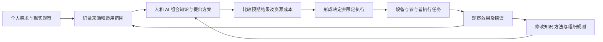

# 共智自由协作的整体理论框架

2026 年 10 月 25 日整理稿。构想来自用户的连续讨论；结构、命名与实施建议由 Codex 整理。本文不是用户对新增细节的逐项采纳，也不宣称整套制度已经得到验证。原话见 [讨论原文](01-originals.md)，演化关系见 [思想脉络](03-evolution.md)。沿用既有研究的“共智自由协作”工作名称，尚未确定组织名称。

## 核心命题与分析单位

人的感知、学习、沟通和执行能力影响其能够组织多大规模的合作。用户提出：当人、个人 AI、公共 AI、机器人、自动设备和传感器能够持续共同感知、推演、行动与纠错时，社会的组织能力可能突破以生物个体及其传统层级协作为中心的限制。这里的 AGI 指向整个现实协作网络所呈现的能力，不能直接等同于一个语言模型。（R16，S16）

这是一项关于智能载体和组织形式的架构假说。其研究对象包括信息如何进入系统、不同判断如何组合、执行结果怎样返回，以及网络如何修改自己的知识、工具和规则。现有理论与实验作为比较材料，不能预先规定新架构必然遵循现存机构的边界，也不能因称为高阶文明而跳过具体机制。

## 三类需要同时回答的问题

**能力问题**：怎样让分散的经验、知识、代码和设备，在具体任务中被发现、理解、组合和改进？

**组织问题**：谁提出目标、谁表达需求、谁决定共同资源用途、谁承担任务，又怎样处理结果反馈？

**演化问题**：新组织怎样从一个人的实际生活中开始，在能够持续提供服务的条件下扩大，并让参与者自由调整参与程度？

用户的目标贯穿三者。仅有个人数据迁移或开放软件代码，都只覆盖其中一部分；生产、设计、运营和分配的组织机制同样属于构想。（R14，S10–S15）

## 系统中的六项组成

| 组成 | 提供的能力 | 在最初一个人阶段的形式 |
| --- | --- | --- |
| 个人数字空间 | 保存记录、需求、作品、偏好及本人允许使用的经验 | 本地资料库、密钥、加密备份、可独立读取的导出包 |
| REA 迁移能力 | 回收旧服务中的个人积累并恢复可用关系 | 官方导出与本地文件适配器、附件清单、缺口记录 |
| 公共知识与来源记录 | 保存公开知识、方案、反例、贡献和变更理由 | PKST Merkle-DAG，私有材料与公共材料分别管理 |
| 共同智能网络 | 连接人的经验、AI 分析、设备观察及行动反馈 | 一人和多个已有 AI 的有界任务协作；不宣称已经形成 AGI |
| 生产与资源组织 | 提供服务，记录成本，安排工作与公共投入 | 小额预算、维护记录、明确的服务范围 |
| 文化与体验系统 | 让陌生机制变得可理解、可体验、可讨论 | 宣言、短篇小说、说明视频、后续交互原型 |

六项组成并非都需要从头开发。复用开源软件、租用基础设施、保留兼容接口，是早期获得实际能力的路径；自主研发根据反复出现的真实缺口展开。

## 两类资源分配

用户区分个人生活与发展所需的资源，以及维持集体生产、研究和运行所需的资源。（H3，R14）

第一类以具体需求为出发点。需求的表达、调整和隐私属于制度设计内容，不能简单用贡献条数或投入金额替代。早期组织只能提供自己实际承担得起的服务保障，例如明确的存储配额、恢复协助和退出包；不能把远景中的充分供给写成当前承诺。

第二类通过共同智能网络处理：汇总需求和事实、提出多个方案、估计成本与结果、形成决定、限定执行范围、收集实际反馈，再调整方法。资金投入、劳动贡献和公共预算分别记账，具体分配规则随组织发展讨论确定。

H3 曾以“正态分配”描述个人需求分配。该原话保留；本稿将它作为待研究的经验假设，不把某种统计分布直接设为个人应得额度。是否采用这种分布、有哪些领域适用，仍是开放问题。

## 动态权重与实际执行

用户设想集体资源和共同事务由参与者的动态权重智能网络处理。最初不需要模拟一个庞大议会：一人明确目标，多种方法提出可比较预测，执行后保存结果。新增参与者后，增加需求表达、任务贡献和共同决策的实际入口。

实施建议是为每件事项分别记录：问题范围、受影响者、备选方案、各节点依据、预测、方法权重、预算、决策理由、执行者和反馈。权重的对象及更新方法必须公开可检查。对于能够得到反馈的预测任务，可以与简单平均、近期窗口、固定方法作比较；对于生活目标与需求，系统需要保留人的表达与选择，而非把预测分数直接当成需求的价值。

既有 E002 合成实验表明，某些动态聚合方法在特定变化条件下优于均值，也存在近期窗口更好及快速变化时变差的结果。这限制了某个算法的普遍优越性主张，没有检验用户本轮提出的完整共同智能架构。后续应比较完整任务闭环的质量、纠错时间、参与成本和资源消耗。

## 从知识积累到共同能力

一个任务可以按如下循环运行：

Merkle-DAG 保存内容版本、引用和变更关系，帮助检查某条结论用了什么材料、哪些判断被修正。哈希校验能够检测取得的内容是否与指定版本一致；保留可信根和独立副本，才能核对历史是否被替换。观察真实性、当前授权、数据可用性和公平性需要相应的其他机制。

贡献记录首先回答“做过什么、依据在哪里”。一条有效记录可以是代码、纠错、需求发现、维护、翻译、负结果或照护工作。记录数量不自动等于贡献价值，重复复制不应被算成新增贡献，记录也不自动构成投资份额或永久决策地位。

## 经济与文化共同发展

实际服务提供使用价值，带来需求反馈、协作经验和可核算的收入。文化作品把日常选择、共同生活与制度矛盾呈现为可体验的故事，帮助人们判断是否愿意尝试。参与者可以从阅读、使用一项服务、提交一次反馈开始，逐渐承担更多建设工作。

“自我实现”在本稿中表示：作品提出可尝试的生活与协作方式，现实试验检验它，试验结果再修改作品和机制。故事里的理想结果不作为现实的成功证据。文化预算与基础服务预算分别记录，用户数据也不会因为参加服务而自动进入作品或训练集。

## 和平演化与长期公共事务

H4 明确提出非暴力、自愿加入退出和兼容迁移。本轮 R18 提出逐步“消灭传统的商业公司和国家政治机构”的远景目标。两个表述均按原文保留。本路线将实践路径设计为自愿采用、组织与服务替代、经各方同意的整合，以及在获得公众授权时承担公共事务；这是 Codex 的操作化方案，不冒充用户已经解决了所有概念张力。

经济服务的用户规模不能直接当作政治授权。公共事务阶段需要面向所有受影响者公开讨论，并通过和平、合法、民主的制度程序推进。具体法域、组织形态和资金安排未确定，本稿不预设已有政治或法律地位。

## 可以改变方案的观察

| 工作假说 | 应观察什么 | 出现什么情况应调整 |
| --- | --- | --- |
| 自主空间提高个人实际控制能力 | 原平台离线后的读取、恢复、迁移和继续工作 | 文件虽导出但关系丢失，或恢复依赖原运营者 |
| 共同智能改善复杂任务 | 与同预算简单方法比较质量、纠错与参与成本 | 增加系统复杂度却没有稳定净收益 |
| 开放组织增强合作与创新 | 有效贡献的采用、反馈回应、贡献者持续参与 | 维护负担集中、贡献被遗漏、决策入口难以使用 |
| 规模增长改善服务与分配 | 单位总成本、可靠性、需求覆盖和分配结果 | 规模增长主要消耗维护资源或形成不可替换节点 |
| 文学和体验降低理解成本 | 读者能否准确区分事实、设想和自己的选择 | 读者把虚构成就当成现实承诺 |

本阶段的成果是可追溯的框架、具体方案和文稿。新组织、共同智能及其社会效果，需要在实际使用中继续形成。
