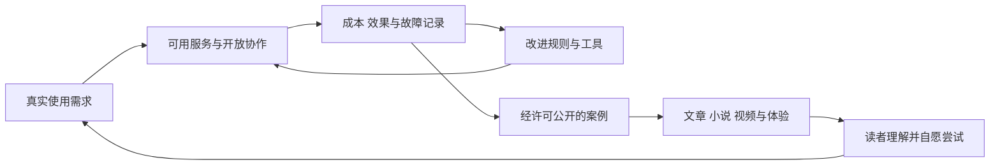

# 从个人服务到开放协作网络的发展路线

2026 年 10 月 25 日方案。人数与时间是规划尺度，不是已达成结果；升级取决于验收，不以筹款达到某个数额为启动条件。服务、组织和文化三条线并行，基础服务恢复与维护优先于扩张宣传。

## 分阶段建设

| 阶段 | 服务与资源 | 组织机制 | 文化作品 | 进入下一阶段的条件 |
| --- | --- | --- | --- | --- |
| 0 一人自用，约前两周 | 个人资料盘点、原件固定、本地检索、加密云备份试验 | 发起人决策台账、支出上限、数据授权范围 | 宣言讨论稿、完整短篇、视频脚本 | 选定样本可独立恢复，缺口明确，自己持续使用 |
| 1 一人完整服务，约首月 | 云端副本与第二设备恢复；可选租用单实例自管文件服务 | 公布真实成本、故障、规则修改和维护工时 | 真实操作演示加短篇朗读视频 | 连续 30 天运行记录；一次原供应端不可用演练；恢复目标达到 |
| 2 自愿小规模试用，参考 2 至 10 人 | 账户隔离、每人密钥、配额、支持入口、可迁移退出包 | 加入规则、费用说明、任务协作、首次共同决策 | 小说三至六篇，公开答疑与更正页 | 每位试用者能取回自己的数据；至少两人掌握运维；没有未覆盖的恢复责任 |
| 3 可持续基础服务 | 文件存储之外，按需求增添协作文档或个人知识检索 | 分开记录消费、贡献、共同预算；形成可复核的分配实例 | 短篇集、低成本短片系列 | 经常性收入覆盖经常性现金支出、维护和约定储备；使用者愿意继续使用 |
| 4 多节点与有限云计算 | 不同地点的资源节点、可替换接口、小规模推理任务；试验按需购买硬件 | 节点责任、共同规则和局部自治；公开任务评价 | 交互小说、桌面规则、网页协作游戏原型 | 节点迁移可执行；任务总成本与质量达到预设标准；备份独立于单一运营点 |
| 5 多行业协作与研发 | 在需求明确的领域组合现有生产能力；逐步批量采购与专项研发 | 新成员和原组织自愿整合，逐项明确资产、工作和责任安排 | 扩展长篇世界观，游戏中的任务可自愿转为现实项目 | 每一新领域均有负责人、知识与资源条件和独立验收；基础服务不被挤占 |
| 6 公共事务试验与制度演化 | 在公众授权的具体事务中验证服务能力 | 开放参与、民主决策、公开评价；经和平合法程序改变制度安排 | 展示真实案例及不同生活选择的作品 | 受影响公众的实际同意与可持续服务；商业规模不替代公共授权 |

阶段 4 以后不设必达年份。云计算、训练模型、芯片或硬件制造分别是不同能力，不能仅按成员数推断已经具备。基础服务可以长期停留在一个小而可靠的阶段。

## 硬件发展以总成本和能力决定

租用适合起步和负载不确定时。购买零售设备需要负载稳定、运维有人承担，并能支付电力、网络、备件和异地恢复。批发需要持续需求和库存管理。自行设计制造还需要工程、供应链、质量与售后能力。

比较式为：购买总成本＝设备价＋资金占用＋电力网络＋场地维护＋维修备件＋备份迁移－可实现残值。与同容量、同可用性、同维护口径的租用成本比较。折扣采购、单位标价下降，都不自动说明总成本下降。

模型路线先复用与评估开源模型，然后在任务、许可数据和能力齐备时尝试微调。自建训练只有在已有方案反复无法满足任务，并具备数据、评测、持续算力和维护能力时单独立项。它不是证明组织先进的必经展示项目。

## 每次扩张使用同一张决策卡

1. 哪个持续存在的需求值得解决，谁在实际承担其代价？
2. 复用现有工具、最小实现、自行研发三条路径，各自成本与限制是什么？
3. 本次最多投入多少现金、维护时间和资源；哪些现有服务不能受影响？
4. 什么结果算改善，什么结果要求缩小或停止？
5. 原方案、备份及用户继续工作的路径怎样保留？
6. 试验结束后，公开哪些结果与失败，哪些内容必须保持私人？

## 经济与文化的实际循环

文化作品另有虚构创作空间，不受真实案例限制，但必须能辨认其虚构身份。公开传播的目标是让人理解并作出选择；不采用虚假见证、伪装普通用户的账号、刷量、未经同意的私信或按敏感身份定向制作政治说服内容。

## 保持兼容而逐步替代

每次替代先选择一个具体工作流，例如“保存并找回自己的文件”，再验证文件格式、时间、附件、共享关系和恢复过程。不能把“兼容”笼统理解为复制原产品全部能力。迁移前后的差异单独列出，已无法取得的原数据继续标为缺失。

随着参与扩大，可以自愿吸纳旧组织中的人员、技能与生产设施。整合应保证服务连续、知情选择及各方权利；组织之间的商业整合不产生对未加入公众的治理权。长期目标与当前阶段使用不同的证据和验收口径。
