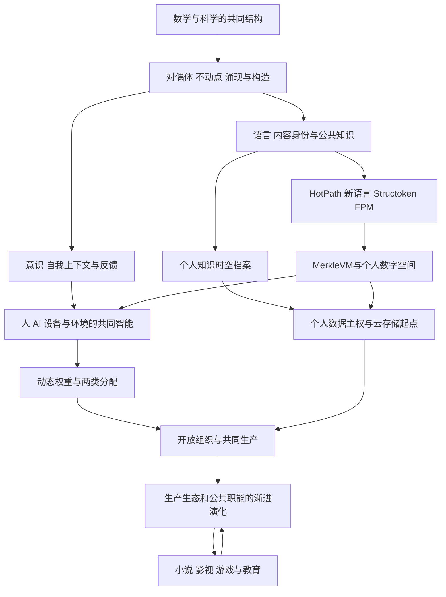

# 《新原理》整合收据

正文、所选原话与主题关系已归档，当前统一索引已切换到此版本。由 Codex 用单独代码重读原始锚、核对引文与文件；尚未由用户逐句审定，也未取得本轮 Claude 独立复核。

- 正文：前言、22章、后记，共 31,112 汉字（含目录、注释）；显式逐字摘录 28 段、5,461 字符。
- 原稿：44,246 字节完全保留。69 个选定文本入口对应 65 个不同原生事件；覆盖 ChatGPT、Claude.ai、Gemini、Codex 和 Claude Code。
- 思想关系：34个新编辑主题，44条主要关系，38个时间线节点；旧目录21个主题全部映射并保持原身份。
- 本次新增原生事件2条，统一目录现有212,353条事件。事件数量包括各类角色，不是思想数量。
- 新稿来源锚、文件身份、引用闭包及完整对象依赖 DAG 校验通过。旧语料沿用已有字节验证记录。
- 文稿 SHA-256：`78a2f5491eb1656c012c9daa49c437e16ef9a900015083d0eee3d48a8587f242`。
- 专题根：`bafyreibmn23kutnklu7pbxknffwrzklpr2ior5z5bglnewhwg575keqhhe`。
- 新统一根：`bafyreibemvkrjo4gqekjzwc6v757o6kpoyz324boy4i77fqaa6veypr6jq`。
- 父统一根：`bafyreifbjnesua4r3p536pwuubztstc7oueaoodxubmzm4o5ipcddiuime`。

## 主要关系的阅读图

以下为已归档 `08-theory-map.json` 的简化阅读投影，箭头表示设想中的展开与应用关系，不代表所有因果关系已经实证。

逐节点定义、来源和关系条件以 [章节映射](04-chapter-map.md) 和 [语义数据](08-theory-map.json) 为准。

[机器校验](../../contributions/codex/new-principles-20261026/verification.json) · [对象与文件报告](../../contributions/codex/new-principles-20261026/report.json)。本收据在根产生后生成，不参与该根的哈希，避免自引用。

材料保持本地；未发布、未购买云资源、未恢复暂停研究。完整历史的逐事件语义抽取尚未声称完成。旧稿中不再沿用的强断言、未采纳的 AI 建议和未激活的中间方向错误均保留。
