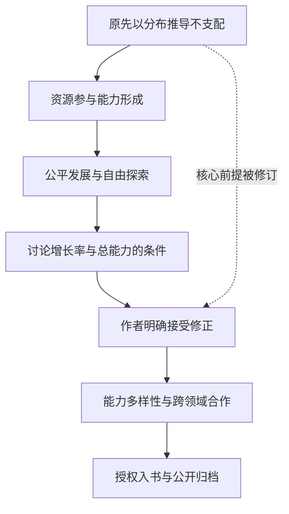

# 从分布前提到能力互补的思想修正

作者在2026年10月31日明确接受对先前绝对化表述的修正，并在随后授权按最新理解入书。本文记录实际发生的讨论；正文呈现最新理解，历史原话不被改写。

## 时间线

以下显示香港时间（UTC+08:00）；原生UTC时间、角色、内容身份与引用范围保存在同名JSON中。

| 时间 | 发言方 | 内容及状态 |
|---|---|---|
|09:00:33.541|作者|以正态分布与非资本式积累解释不会出现支配节点|
|09:59:36.123|作者|指出资源和资本参与能力的训练与形成|
|10:12:32.057|AI|AI区分资源形成机制与普遍正态结论|
|10:46:54.477|作者|作者提出公平发展与自由探索目标，仍尝试推导综合能力分布|
|10:51:59.329|AI|AI补充相同时间、增长率与综合能力计量的区别|
|11:04:15.405|作者|作者明确接受修正，转向能力互补与跨领域合作|
|11:06:06.206|AI|AI整理深入研究、跨域连接及技术支持的分工|
|11:14:50.490|作者|作者要求按最新理解入书、保存思想修正并同步GitHub|

箭头表示讨论承接或明确修订，不表示已经证明的现实因果。

## E01　以正态分布与非资本式积累解释不会出现支配节点

原生时间：2026-10-31T01:00:33.541Z；角色：user。

而人的任何一种需求和任何一种能力，在人群中的分布都是正态分布，而不是幂分布，而且能力和需求不会像财富那样，随着时间的累积，出现指数性的复利增长。所以绝对不可能出现支配性的决策节点，也不会有哪个节点占有支配数量性的代理。

内容 CID：`bafyreifabsetkvgfvqjdfcvnijrundfapstborxxgdva5aonxlkd5fuj3y`。

## E02　指出资源和资本参与能力的训练与形成

原生时间：2026-10-31T01:59:36.123Z；角色：user。

因为人类个体对象的能力训练获取过程中，资源和资本等可复利累积的的资源起到了很大的作用，而旧体制的个体资源分配是按可复利累积的规则进行的，在这种背景下成长起来的人类个体对象的能力就会严重偏离正态分布。

内容 CID：`bafyreif3lxsnqjvrujaun37jhbgmpnjhwhs67ebufbcpyqfcqabutb5mce`。

## E03　AI区分资源形成机制与普遍正态结论

原生时间：2026-10-31T02:12:32.057Z；角色：assistant。

仍须区分：**资源累积能够塑造差距，不等于所有偏态都只由资本造成，也不能直接证明资源平等后所有能力与需求必然正态分布。** 你对跑跳、高尔夫和跳伞的比较有研究价值，我保留了这个具体预测，并明确写成需要控制训练条件、参与者筛选和测量指标的假说。

内容 CID：`bafyreihxipqhipsjwbgcrgh2wjoem2nokucdcjmhlzhww6u56e3fydb2oe`。

## E04　作者提出公平发展与自由探索目标，仍尝试推导综合能力分布

原生时间：2026-10-31T02:46:54.477Z；角色：user。

我的回答是，理性的社会制度，应该完成以下两个目标为诉求：

一方面，让培养机会、设备、与基本生活保障等外部因素更公平，消除外部复利累积因素的影响，让人们的能力分布，更多的会取决于先天基因差异，以及后天偏好不同，这两个个体自身因素。能力的差异由先天遗传因素导致的先天能力差异，累加后天投入的时间/次数来产生。
另一方面，让每个人都能够掌握关于自身和外部世界充足的信息，能够准确判断自身的基因，了解自己的特长，同时提供充足的自由发展的时间和自由，用于自由发展自己偏好的能力。

内容 CID：`bafyreiabkasm4eap3jpe4rel3esz6yi53axgql7mtmuhxzurbosrelguv4`。

## E05　AI补充相同时间、增长率与综合能力计量的区别

原生时间：2026-10-31T02:51:59.329Z；角色：assistant。

我认为，**你的两个制度目标是合理的，也为“降低资源优势转化为支配权的风险”提供了更具体的机制解释。** 不过，“每个人的综合能力因此接近正态分布”，还需要作为一个独立假说检验。

内容 CID：`bafyreidhqwnccbd5f6atexwzmltd75yoid6qquc2bjcfwtopyelsqnq3aa`。

## E06　作者明确接受修正，转向能力互补与跨领域合作

原生时间：2026-10-31T03:04:15.405Z；角色：user。

所以重要的不是让能力去逼近正态分布，而是让系统的机制，能够让这些不同能力的个体建立起最有效的合作，让这些偏科和全面的人们有效沟通合作起来，让完成跨领域的深度合作。

内容 CID：`bafyreibmjc2zo2ydk2lzcfelpn3coamdyg4337sz4rdi5hmigbxg3qxox4`。

## E07　AI整理深入研究、跨域连接及技术支持的分工

原生时间：2026-10-31T03:06:06.206Z；角色：assistant。

它们是任务中的不同角色，同一个人在不同情境下可以承担不同角色，不必把人固定划分成“专才”和“通才”两类。

内容 CID：`bafyreiasm2da3caguzhbmw2wsh6hhg7ry5xghtnok2mkhduoog4ftntvjy`。

## E08　作者要求按最新理解入书、保存思想修正并同步GitHub

原生时间：2026-10-31T03:14:50.490Z；角色：user。

请把最近这几轮讨论整理加入《新原理》，尽量保留我的文字，按最新理解强调公平的发展条件、能力多样性和跨领域合作，同时把原话和从强调正态分布转向强调能力互补的思想修正过程记录进个人知识 Merkle-DAG 库，并同步到 GitHub。

内容 CID：`bafyreihl2afauet3vumngjdvmwpyh5h6nqw72vtwvy4bosdsgx3obtzz3y`。

## 修正的范围

作者明确承认先前表达过于绝对，将重点从能力逼近正态分布转向不同能力的有效合作。公平的发展条件、自由探索与减少支配风险的诉求继续保留；并未把所有先前讨论整体否定，也未把任何新的编辑句子自动视为已获作者逐句确认。
